  

  
  
  

## `$ man william`

Estudante de Ciência da Computação na [UECE](https://www.uece.br/), estagiário de análise de dados na [ApLIS](https://aplis.inf.br/), pesquisador de Machine Learning no [LARCES](https://sites.google.com/view/larces/home) (Laboratório de Redes de Computadores e Segurança) e ex-mentor e analista de dados no [Instituto iREDE](https://www.irede.org.br/).

Gosto de transformar conjuntos de dados complexos em decisões, projetar modelos de machine learning para baixa latência e computação de borda e montar fluxos de dados robustos. Quando não estou treinando modelos, otimizando stored procedures em SQL ou montando dashboards, provavelmente estou explorando sistemas concorrentes em Go.

---

## `$ ls -l projetos/destaque`

> Machine learning, pesquisa em segurança e sistemas orientados a dados.

| Projeto | Descrição | Tecnologias |
| --- | --- | --- |
| [**MQTT Under Attack**](https://github.com/William-SWS/mqtt_under_attack) | Benchmarks de machine learning avaliando modelos clássicos para detecção de DoS de baixa latência em computação de borda e ambientes IoT. | Python · FastAPI · Scikit-Learn · Jupyter · IoT · Edge AI · Anomaly Detection |
| [**Fashion Classificator**](https://github.com/William-SWS/fashion-classificator) | Pipeline de visão computacional no Fashion-MNIST que avalia o impacto de filtros de pré-processamento, engenharia de atributos e modelos de classificação. | Python · OpenCV · Scikit-Learn · Visão Computacional · EDA · Jupyter |
| [**ADFA-LD Attack Detection**](https://github.com/William-SWS/Deteccao-de-Ataques-com-ADFA-LD) | Benchmark de segurança de sistemas operacionais que classifica traços de chamadas de sistema (syscalls) com Random Forest para detectar comportamento de intrusão. | Python · Random Forest · Machine Learning · Syscalls Linux · Segurança |
| [**CareerPath-AI**](https://github.com/CareerPath-AI) | Plataforma com LLMs que adapta currículos, compara as competências de candidatos com as vagas e recomenda trilhas de estudo. | Python · LLMs · FastAPI · LangChain · Prompt Engineering · Modern Data Stack |

---

## `$ ls -l projetos/estudos`

> Experimentos de concorrência, análise exploratória de redes e aprendizado contínuo.

| Projeto | Descrição | Tecnologias |
| --- | --- | --- |
| [**Drinking Philosophers in Go**](https://github.com/William-SWS/drinking_philosophers_in_go) | Implementação do problema dos filósofos bebedores de Chandy-Misra, tratando alocação distribuída de recursos e gargalos de sincronização. | Go · Goroutines · Channels · Algoritmos Distribuídos · Concorrência |
| [**MQTT Exploration**](https://github.com/William-SWS/mqtt_exploration) | Análise exploratória (EDA) e perfilamento de datasets de tráfego MQTT para caracterizar o comportamento da rede sob diferentes ataques. | Python · Pandas · NumPy · Matplotlib · Seaborn · Perfilamento de Rede |
| [**ML Zoomcamp Portfolio**](https://github.com/William-SWS/machine-learning-zoomcamp-course) | Documentação, exercícios e fluxos de deploy do Machine Learning Zoomcamp da DataTalks.Club. | Python · Docker · Flask · Scikit-Learn · MLOps · Deploy |

<code>$ exit</code>

